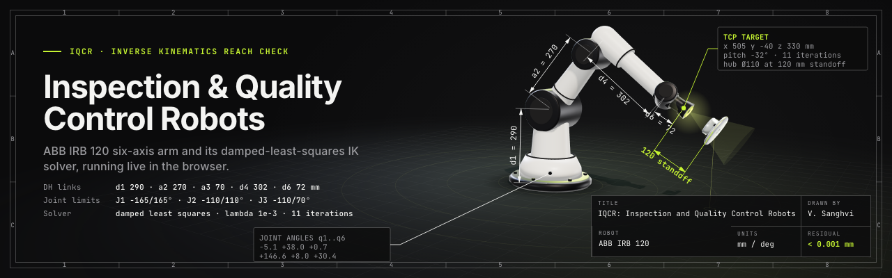

<p align="center">
  <a href="https://veer-sanghvi.github.io/IQCR/"></a>
</p>

# IQCR: Inspection and Quality Control Robots

Live 3D simulation of an ABB IRB 120 six-axis arm and its inverse-kinematics solver, running client-side in the browser.

[](https://github.com/Veer-Sanghvi/IQCR/actions/workflows/tests.yml)

**[Live demo →](https://veer-sanghvi.github.io/IQCR/)**

## What the page does

IQCR proposes putting a camera, depth sensor, and laser probe on one robot arm instead of running parts between separate inspection stations. Before any of that sensor fusion gets built, the arm has to physically reach the poses the idea requires.

This page runs the same ABB IRB 120 kinematics and the same damped-least-squares inverse-kinematics solver as the paper, live in 3D:

1. **Manual pose control**: drive all 6 joints directly and watch the arm move, built from the IRB 120's Denavit-Hartenberg table.
2. **Inverse kinematics**: generate a random target pose, perturb the arm's starting guess, and watch the solver converge back, or fail to if you push the perturbation high enough; the revised paper's failure study traces every reproducible failure to a joint-limit-infeasible target, certified by a closed-form solver.
3. **Reachable workspace envelope**: a live 60×60 grid sweep showing where the hand can physically reach.

Every run is compared against the paper's original MATLAB results and an independent cross-check against MATLAB's Robotics System Toolbox, so the hand-coded solver isn't grading its own homework.

## Correction (Nov 2026)

The paper's hand-coded MATLAB script paired the standard DH matrix with a twist list shifted by one joint, so its hand-coded table describes a six-axis arm with the IRB 120's link lengths but not its joint layout. The Robotics System Toolbox results, which use ABB's own model, are unaffected. This page now uses the corrected IRB 120 parameters: twists [-90, 0, -90, 90, -90, 0] deg, a joint-2 offset of -90 deg, and the datasheet joint limits, taken from the table the toolbox exports for `loadrobot('abbIrb120')` ([`ikIRB120.m`](conference_paper/matlab_source/ikIRB120.m)). With them q = 0 is the upright pose with the TCP at (374, 0, 630) mm. [`tests/fk-check.js`](tests/fk-check.js) checks that pose and reproduces the 108 recorded toolbox TCP distances in the repo's CSVs. `iqcr_kinematics.m` is kept unchanged as the script behind the published table; [`iqcr_kinematics_irb120.m`](conference_paper/matlab_source/iqcr_kinematics_irb120.m) is the like-for-like rerun on the corrected arm.

## Paper

Co-authored with Tyler Fong and Syed Irtiza Ali Shah at Wentworth Institute of Technology. Presented at IEEE ICACR 2026 (Nanjing, China, October 2026).

Paper as submitted: [`conference_paper/IQCR.pdf`](conference_paper/IQCR.pdf)
Final paper (ICACR 2026): [`conference_paper/IQCR_camera_ready_6page.pdf`](conference_paper/IQCR_camera_ready_6page.pdf)

The client-side solver in [`kinematics.js`](kinematics.js) is the damped-least-squares solver of [`conference_paper/matlab_source/iqcr_kinematics.m`](conference_paper/matlab_source/iqcr_kinematics.m), ported to JavaScript and run on the corrected IRB 120 table above.

## Running locally

The page uses ES module import maps, so it needs to be served rather than opened directly as a file:

```sh
npx serve .
# or
python3 -m http.server
```

Then open the printed local URL in a browser.

## Tests

```sh
npm install
npx playwright install --with-deps chromium
npm test
```

`npm test` runs [`tests/fk-check.js`](tests/fk-check.js) (the DH table against the toolbox CSVs) and then the Playwright suite. Tests run automatically on push/PR via GitHub Actions ([`.github/workflows/tests.yml`](.github/workflows/tests.yml)).

## Repo layout

```
index.html                              Page markup and styling
kinematics.js                           Client-side forward/inverse kinematics solver
arm-model.js                            The IRB 120 model (links, housings, sensor, studio lighting) shared by the viewer and the hero
scene.js / app.js                       3D viewer and UI wiring; IK targets shown as a flange part to inspect
hero.js                                 Showpiece hero: the same arm, pointer-tracking IK
og/                                     Link-preview card source and its Playwright render script
assets/readme/                          README banner and its scene (same arm model and solver, rendered by Playwright)
tests/iqcr.spec.js                      Playwright tests
tests/fk-check.js                       Node check of the DH table against the toolbox CSVs
conference_paper/
  IQCR.pdf                              Paper as submitted
  IQCR_camera_ready_6page.pdf           Final paper (ICACR 2026)
  matlab_source/iqcr_kinematics.m       Original hand-coded MATLAB solver (as published, shifted twist list)
  matlab_source/iqcr_kinematics_irb120.m  Same solver on the corrected IRB 120 DH table
  matlab_source/rst_verification.m      Independent cross-check via Robotics System Toolbox
```

## Related work

Each line says what the paper covers and where it touches IQCR. None of them claims IQCR extends it.

1. [Denavit and Hartenberg (1955). A Kinematic Notation for Lower-Pair Mechanisms Based on Matrices. Journal of Applied Mechanics.](https://doi.org/10.1115/1.4011045) The original paper on DH parameters; the live demo builds the ABB IRB 120 arm from its table.
2. [Wampler (1986). Manipulator Inverse Kinematic Solutions Based on Vector Formulations and Damped Least-Squares Methods. IEEE Transactions on Systems, Man, and Cybernetics.](https://doi.org/10.1109/TSMC.1986.289285) One of the founding papers on damped least-squares inverse kinematics, the solver type in `kinematics.js` and the MATLAB source.
3. [Buss and Kim (2005). Selectively Damped Least Squares for Inverse Kinematics. Journal of Graphics Tools.](https://doi.org/10.1080/2151237X.2005.10129202) A refinement of damped least squares aimed at the convergence trouble seen in the one failed pose.
4. [Di Vito et al. (2017). A Comparison of Damped Least Squares Algorithms for Inverse Kinematics of Robot Manipulators. IFAC-PapersOnLine.](https://doi.org/10.1016/j.ifacol.2017.08.1209) Benchmarks damped least-squares variants against each other, a reference point for the solver-versus-closed-form comparison.
5. [Gurau et al. (2024). Laser Scanner-Based Robotic Coordinate Measuring Machine. International Journal of Mechanical Engineering and Robotics Research.](https://doi.org/10.18178/ijmerr.13.1.161-168) Puts a laser scanner on a robot arm for dimensional measurement, close to the arm-mounted inspection cell IQCR proposes but has not built.

## Cite

GitHub reads [`CITATION.cff`](CITATION.cff); use the "Cite this repository" button, or:

```bibtex
@inproceedings{sanghvi2026iqcr,
  author    = {Sanghvi, Veer and others},
  title     = {Inspection and Quality Control Robots},
  booktitle = {IEEE ICACR 2026},
  address   = {Nanjing, China},
  year      = {2026},
  url       = {https://veer-sanghvi.github.io/IQCR/conference_paper/IQCR_camera_ready_6page.pdf}
}
```

## Contact

Veer Sanghvi · [veer-sanghvi.github.io](https://veer-sanghvi.github.io/)
